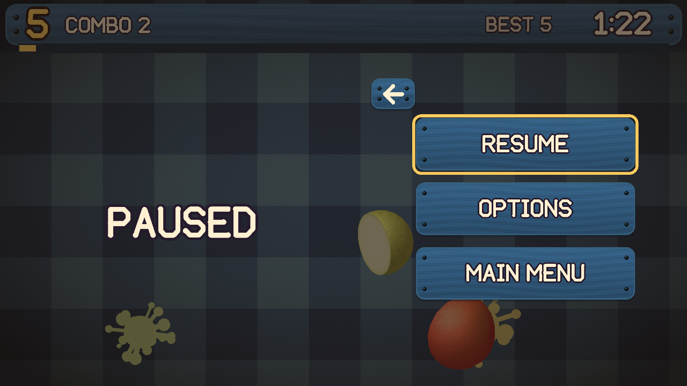

# Fruit Slicer

A free, fan-made fruit-slicing arcade game for Windows, Linux and Android. Swipe to cut fruit out of the air, chain combos and stay away from the bombs. A two-screen version for the Nintendo 3DS lives at [fruit-slicer-3ds](https://github.com/RealAnxiousGit/fruit-slicer-3ds), built from the same game code.

**Status: Alpha.** Tested on Windows 11 on all four renderers, on Linux under WSL, and on a real Android phone as well as the Android emulator. Native Linux desktops and more phones are still untested, so reports are welcome.

All screenshots are from the Windows version.

<p>
  
  
  
  
  
  
  
</p>

## Download

Get the files from the [Releases](https://github.com/RealAnxiousGit/fruit-slicer/releases) page.

| Platform | File | How to run |
| --- | --- | --- |
| Windows 10 or 11 | `FruitSlicer-*-windows-x64.zip` | Unzip it and run `FruitSlicer.exe`. Keep the `romfs` folder beside the game. |
| Linux | `FruitSlicer-*-x86_64.AppImage` | Mark it as executable and run it. |
| Linux | `FruitSlicer-*-linux-x86_64.tar.gz` | Unpack it and run `FruitSlicer`. |
| Android 5.0 or newer | `FruitSlicer-*-android.apk` | Open it on your phone and allow the install. |

The Linux builds need glibc 2.35 or newer, which means Ubuntu 22.04 or newer or something similar.

## Controls

| Windows and Linux | Action |
| --- | --- |
| Mouse | Hold the button and swipe to slice. Click anything in a menu. |
| Mouse wheel | Scroll a settings list |
| Escape | Pause, and go back one menu |
| Arrow keys or WASD | Move the selector, change a setting |
| Enter or Space | Select |
| F11 or Alt+Enter | Fullscreen |

| Android | Action |
| --- | --- |
| Finger | Swipe to slice. Tap anything in a menu, and drag a settings list to scroll. |
| Pause sign, top left | Open the pause menu. Resume carries on. |
| Back | Pause, and go back one menu. On the title screen, leave the game. |

## Modes

| Mode | Rules |
| --- | --- |
| Classic | Three missed fruit and you're out. A bomb ends the run. |
| Arcade | 60 seconds. Bombs cost 10 points, your combo and half the Frenzy meter. Slice power-ups: Frost slows time, X2 doubles points, Fruit Storm throws fruit in from the sides. Ends on the Sunburst Fruit. |
| Zen | 90 calm seconds with no bombs and no misses. |
| Frenzy | 30 seconds of nonstop fruit. Bombs take 5 seconds off the clock, and a Fruit Frenzy throws fruit even faster. A bomb in the last 5 seconds brings the Sunburst Fruit straight away. |
| Sudden Death | One miss or one bomb ends the run. Fruit is worth double. |
| Minefield | Bombs take over as the run goes on. Missed fruit is free, and one bomb ends the run. |
| Combo Rush | 45 seconds of big fruit patterns. Swipe bonuses are doubled and bombs cost 10 points, your combo and half the Frenzy meter. Ends on the Sunburst Fruit. |

**Scoring:** 1 point per fruit, 3 for a coconut and 5 for a rare golden star fruit. The COMBO count on the sign rises with every fruit, and each 15 adds a 5-point bonus. A bomb or an empty Frenzy meter resets it. A missed fruit does not.

**Swipe combos:** slicing 3 or more fruit in one stroke earns a bonus, and each tier has its own sound and effects: Nice (3), Great (4), Awesome (5), Super (6), Insane (8) and Legendary (10). The bonus is the number sliced, multiplied by 2 from Awesome, 3 at Insane and 4 at Legendary.

**Fruit Frenzy:** slicing fills the meter under the score sign. It drains all the time, so keep slicing to push it up. Easy drains it slowly and each slice adds more; Hard and Insane drain it faster and each slice adds less. If it runs dry, your COMBO resets. Fill it for 7 seconds of double points and a shower of fruit. Bombs already on their way fizzle out, and fruit from the shower can't count as a miss.

**Sunburst Fruit:** when the clock runs out in a mode that has it, one giant fruit rises and hangs in the air for 4 seconds. Scrub the blade across it as fast as you can. Each hit scores 1, every 10th hit adds 5, and it bursts at the end for 2 more per hit.

**Coconuts** take two hits. The first one cracks the shell and knocks it back up.

**Difficulty:** Easy, Normal, Hard and Insane change how fast fruit is thrown and how many bombs come with it. Easy throws the fewest bombs. Hard and Insane can throw two bombs in one wave (never in Sudden Death), and in Minefield bombs make up as much as two thirds of the throws on Insane.

## Options

| Section | Settings |
| --- | --- |
| Audio | Sound Effects, Music and Menu Sounds sliders. Menu Music and Game Music each choose Auto or a track. |
| Visuals | Art Style (3D Models or 2D Stickers), Board, Blade, Effects, Screen Shake, 3D Detail, Slice Style, Transitions and Renderer. |
| Gameplay | Difficulty (Easy, Normal, Hard, Insane), Fruit Speed, Bomb Amount, Slice Forgiveness, Frenzy Drain and Misses Allowed. Android adds Touch Sensitivity. |
| Scores and Data | Reset scores or everything. |

**Renderers:** Windows offers DirectX, OpenGL, Vulkan and Software. Linux and Android offer OpenGL, Vulkan and Software. Software always uses the 2D stickers. If a renderer can't start on your machine, the game picks one that can.

Scores and settings are saved in `%APPDATA%\RealAnxiousGit\FruitSlicer` on Windows and `~/.local/share/RealAnxiousGit/FruitSlicer` on Linux. Android keeps them in the app's private storage. 0.4.0 uses a new save format, so everyone starts with default settings and no scores. Saves from earlier versions are not carried over.

## Build from source

You need CMake 3.16 or newer and a C++17 compiler. SDL 3.4.2 is downloaded and built in during the first build, so players never have to install it. On Linux, SDL also needs the usual X11, Wayland and audio development packages.

**Linux:**

```bash
cmake -S . -B build -DCMAKE_BUILD_TYPE=Release
cmake --build build
./build/FruitSlicer
```

**Windows, cross-compiled from Linux with MinGW-w64:**

```bash
cmake -S . -B build-win -DCMAKE_TOOLCHAIN_FILE=cmake/mingw-w64.cmake
cmake --build build-win
```

**Android:** install the Android SDK with NDK 28.2.13676358 and CMake 3.22.1, then:

```bash
cd android
./gradlew assembleDebug
```

`-DAUTOTEST=ON` builds a version that plays every mode by itself and logs the results.

## How it works

- **Shared game:** `source/` holds the rules, menus, scoring and cutting, and is kept byte-for-byte the same as in the 3DS repo. `port/` holds what is specific to this version. `shared-files.txt` lists the shared files, and `scripts/sync-shared.py` copies changes across and flags any drift.
- **Rendering:** SDL 3's renderer with batched triangles. 3D fruit are code-generated meshes with HD detail maps, lit and depth-sorted on the CPU, so DirectX, OpenGL and Vulkan all share one code path.
- **Timing:** the game advances 60 steps per second of real time, however fast frames can be shown.
- **Slicing:** in 3D with Exact slices, a cut really splits the mesh along your swipe and caps it with a coloured face. Otherwise each fruit uses ready-made halves. Android's Frenzy always uses ready-made halves and throws a little less.
- **Memory:** fruit, halves, particles, splats, popups and spawn queues live in fixed pools, so gameplay never allocates memory for them. A phone with under 3 GB of RAM loads pictures at half size and starts on 2D stickers with lighter effects. 3D is still in Options.

## Assets

Everything is generated from code in [`tools/`](tools) with Pillow and numpy: sprites, boards, 3D models, HD textures, logo, font, sound effects and the rest of the music. The six Shop music tracks are recorded music by another artist (see Credits). Apart from those, the project uses no third-party art, fonts, samples or game files. The generated files are committed, so building only needs a compiler. [`tools/gen_steam_art.py`](tools/gen_steam_art.py) draws the cover, banners, logo and icon in [`docs/steam`](docs/steam).

**AI disclosure:** this game was made with an LLM. Claude wrote the code and the generator scripts that produce the art, sound and most of the music, directed and playtested by the project owner.

See [CHANGELOG.md](CHANGELOG.md) for what changed, and [docs/qa](docs/qa) for how each release was tested.

## Credits

Programming by Claude. Prompt engineering by RealAnxiousGit.

**Music:** the six Shop tracks (Summer House, 8-Bit Hero Quest, Friendly Trap, Unruly Beat, Vengeance Electro and Eternal Explorer) are by [Of Far Different Nature](https://fardifferent.carrd.co/), from "Loop Box #1" and "Loop Box #4" on [OpenGameArt.org](https://opengameart.org), licensed under [CC BY 4.0](https://creativecommons.org/licenses/by/4.0/). They were converted (to Ogg Vorbis) and turned down to match the game's loudness.

**Libraries and build tools:**

- [SDL 3](https://libsdl.org) (zlib license)
- [stb_vorbis](https://github.com/nothings/stb) by Sean Barrett (public domain or MIT), which plays the Shop music
- [CMake](https://cmake.org), [Ninja](https://ninja-build.org), GCC and [MinGW-w64](https://www.mingw-w64.org)
- [Android SDK and NDK](https://developer.android.com), [Gradle](https://gradle.org) and the Android Emulator
- [appimagetool](https://github.com/AppImage/appimagetool)
- [Python](https://www.python.org), [Pillow](https://python-pillow.org) and [numpy](https://numpy.org), which generate the art, sound and music

**Toolkits and helpers:**

- [Claude Code](https://claude.com/claude-code)
- [Claude Code Game Studios](https://github.com/Donchitos/Claude-Code-Game-Studios) by Donchitos: review and QA workflows
- [Anti Slop](https://github.com/miqdadbadjuber/anti-slop) by miqdadbadjuber: interface rules
- Graphify: code knowledge graph

## License

Code and assets are licensed under [CC BY-NC 4.0](LICENSE): free to share and adapt with credit, not for commercial use. The Shop music tracks keep their own CC BY 4.0 license from their author. SDL is used under the zlib license, and its Android Java files are included in `android/app/src/main/java/org/libsdl`.

This is an independent fan project, not affiliated with or endorsed by any game publisher.
