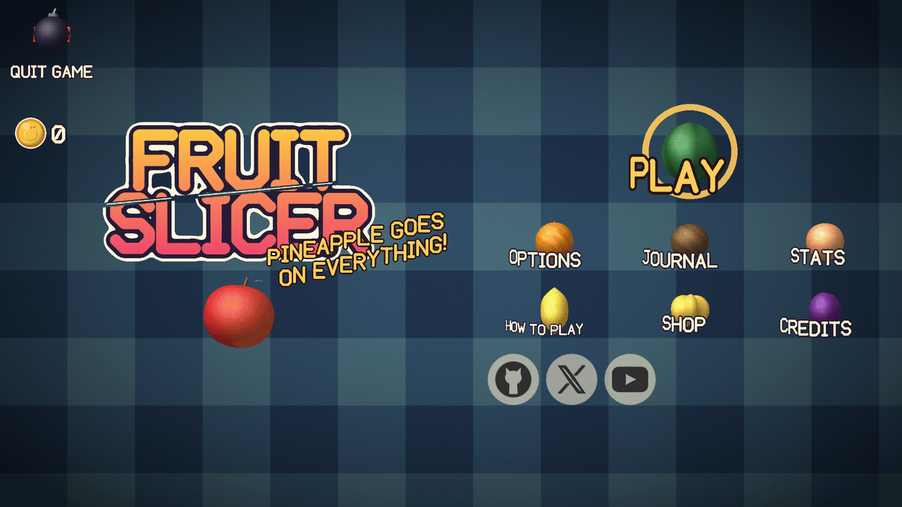
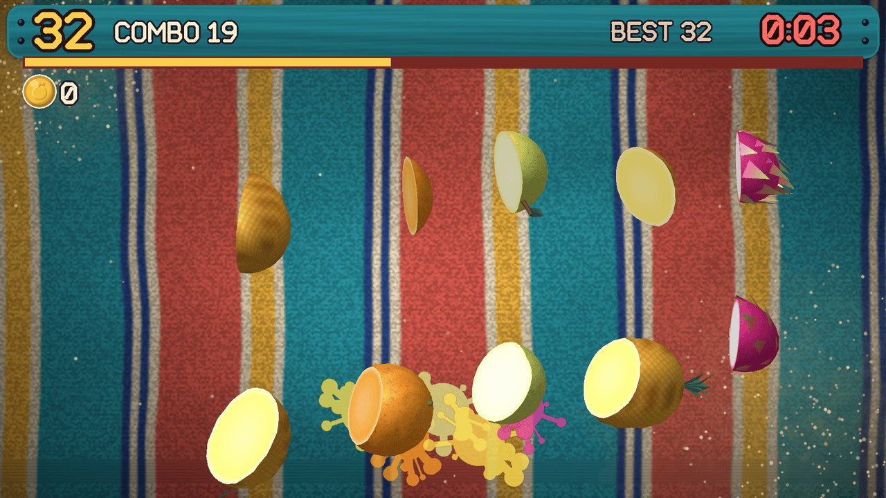
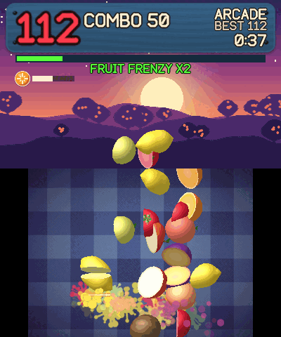
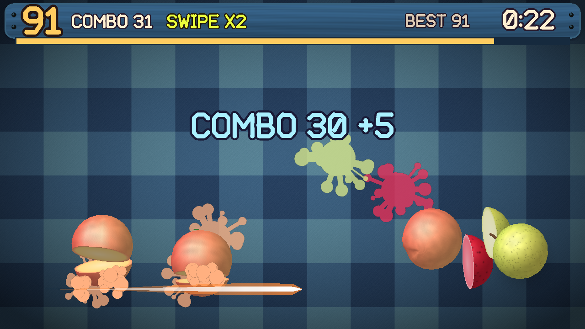
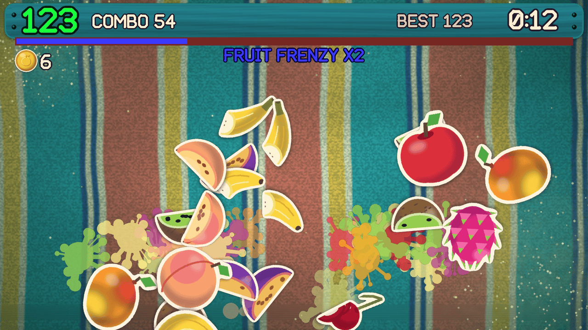
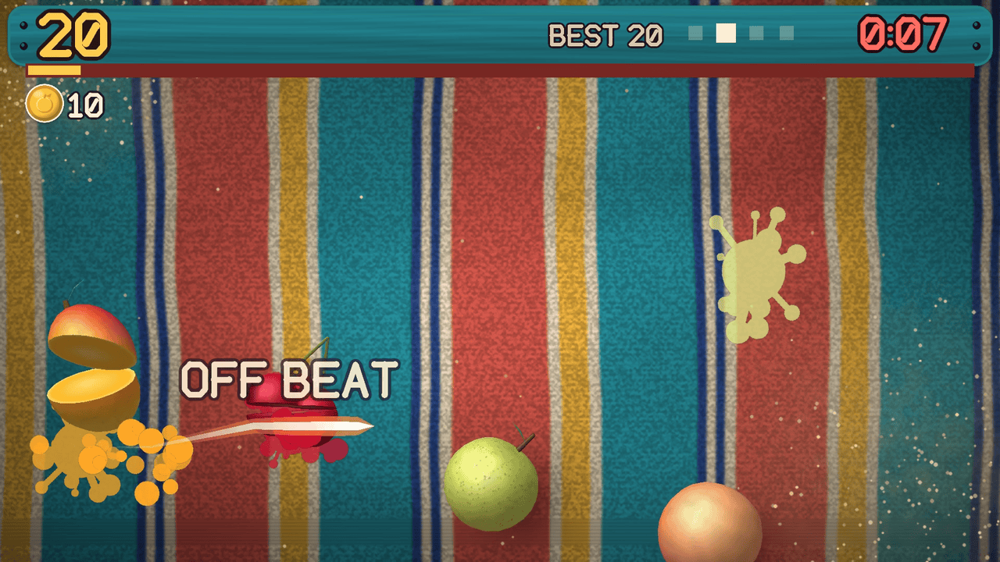
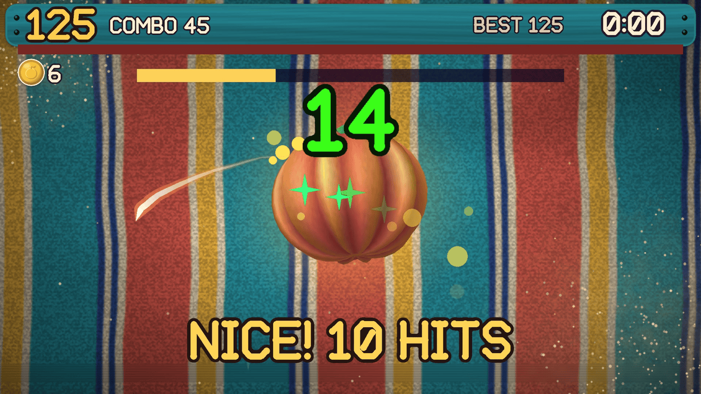
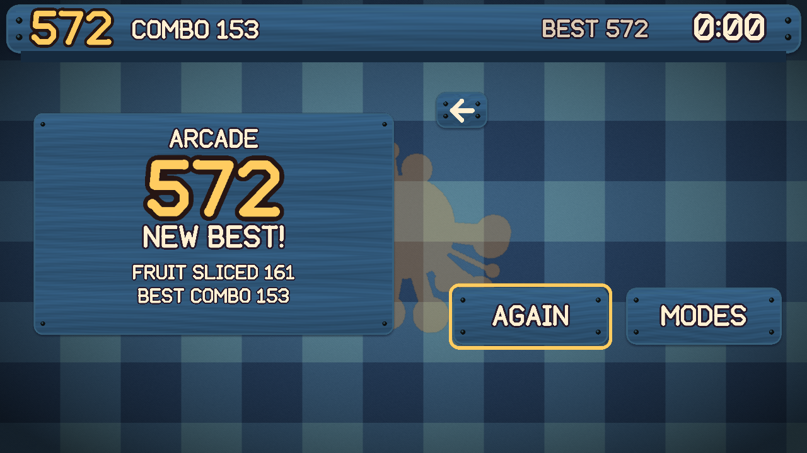

# Fruit Slicer

A free, fan-made fruit-slicing arcade game for Windows, Linux and Android. Swipe to cut fruit out of the air, chain combos and stay away from the bombs. A two-screen version for the Nintendo 3DS lives at [fruit-slicer-3ds](https://github.com/RealAnxiousGit/fruit-slicer-3ds), built from the same game code.

**Version 1.1.0.** Tested on Windows 11 on all four renderers, on Linux under WSL, and on a real Android phone as well as the Android emulator. Native Linux desktops, more phones and real 4K monitors are still untested, so reports are welcome.

All screenshots are from the Linux version.

<p>
  
  
  
  
  
  
  
  
</p>

## Download

Get the files from the [Releases](https://github.com/RealAnxiousGit/fruit-slicer/releases) page.

| Platform | File | How to run |
| --- | --- | --- |
| Windows 10 or 11 | `FruitSlicer-*-windows-x64.zip` | Unzip it and run `FruitSlicer.exe`. Keep the `romfs` folder beside the game. || Linux | `FruitSlicer-*-x86_64.AppImage` | Mark it as executable and run it. |
| Linux | `FruitSlicer-*-linux-x86_64.tar.gz` | Unpack it and run `FruitSlicer`. |
| Android 5.0 or newer | `FruitSlicer-*-android.apk` | Open it on your phone and allow the install. |

The Linux builds need glibc 2.35 or newer, which means Ubuntu 22.04 or newer or something similar.

**Updates:** from 1.0 on, the game can check GitHub for a newer release, once a day and only if you say yes on the first start (Options > Scores and Data changes it, and has Check Now). Nothing about you is sent. It shows what's new, downloads the update and installs it: Windows and Linux replace the game's files after you restart, and Android hands the new APK to the system installer. 0.4 has no update check, so update from 0.4 by hand. Your scores and settings carry over.

## Controls

| Windows and Linux | Action |
| --- | --- |
| Mouse | Hold the button and swipe to slice. Click anything in a menu. |
| Mouse wheel | Scroll a settings list, the Shop, the Fruit Journal or the track list, or turn Pick a Game's page |
| Escape | Pause, and go back one menu. Hold it for 3 seconds on the title to quit. |
| Arrow keys or WASD | Move the selector, change a setting |
| Enter or Space | Select |
| F11 or Alt+Enter | Fullscreen |

| Android | Action |
| --- | --- |
| Finger | Swipe to slice. Swipe across a menu fruit to pick it, and drag a list or the Shop to scroll. |
| Pause sign, top left | Open the pause menu. Resume carries on. |
| Back | Pause, and go back one menu. On the title screen, leave the game. |

| Controller (any SDL-supported pad) | Action |
| --- | --- |
| Left stick | Move the blade point. Hold the right trigger to slice, or set Stick Slicing to Flick and slice with fast moves. |
| D-pad | Move the selector, change a setting |
| Right trigger, in menus | Hold it and the left stick moves a blade point that slices menu signs like a finger |
| A (Cross) | Select |
| B (Circle) | Go back |
| Start | Pause |

**Menus** are fruit: swipe across one to slice it and pick it. With a mouse, a click works too. The selector and Enter or A slice the selected fruit. The GitHub, X and YouTube icons in the title's bottom-left corner open those pages in your browser. Hold the bomb in the top-left corner, Quit Game, for 3 seconds (or hold Escape on the title) to close the game.

## Modes

| Mode | Rules |
| --- | --- |
| Classic | Three missed fruit and you're out. A bomb ends the run. |
| Arcade | 60 seconds. Bombs cost 10 points, your combo and half the Frenzy meter. Slice power-ups: Frost slows time, X2 doubles points, Fruit Storm throws fruit in from the sides. More trick fruit than any other mode. Ends on the Sunburst Fruit. |
| Zen | Calm and endless, with no bombs, no misses and no clock. Finish Run in the pause menu ends it and keeps your score. |
| Frenzy | 30 seconds of nonstop fruit. Bombs take 5 seconds off the clock, and a Fruit Frenzy throws fruit even faster. A bomb in the last 5 seconds brings the Sunburst Fruit straight away. |
| Sudden Death | One miss or one bomb ends the run. Fruit is worth double. |
| Minefield | Bombs take over as the run goes on. Missed fruit is free, and one bomb ends the run. |
| Combo Rush | Only combos score: a fruit on its own is worth nothing, and each one in a long combo is worth more, up to 12. The bigger your combo, the faster fruit comes. Swipe bonuses are doubled. One bomb or an empty combo meter ends the run, and there is no clock. |
| Daily Fruit | 60 seconds, the same run for everyone that day on every platform, with no server. A calendar keeps your daily scores and streak, and each day's first run pays a coin bonus. |
| Beat Slice | 60 seconds to music. Fruit is thrown as usual, but only slices on the beat score, and a streak of them scores more. The board's edges glow when a slice will count. Pick any track you own from the track list. |

Pick a Game shows six signs a page. The arrows beside the signs, left and right, or the mouse wheel turn the page.

**Mixer:** rules that change any mode, in any mix: Low Gravity, Giant Fruit, Tiny Fruit, Mirror, Double Bombs (Zen stays bomb-free) and Sides Only. Runs with a rule on keep their own best scores. Daily Fruit and Beat Slice always play without them. Slice the coconut under Pick a Game's info sign to open it, or press Back or View on a controller.

**Pass and Play:** 2 to 4 players take one run each on the same device, in Classic, Arcade, Frenzy, Sudden Death, Minefield or Combo Rush. Each player has a colour and a name you can type, and a results board shows who won. These runs don't change your bests.

**Practice:** the first Play starts a short, skippable lesson run (a slice, a three-fruit swipe, a coconut, a bomb, a coin, the Frenzy meter and a menu fruit). How to Play replays it.

**Custom Music** (Windows, Linux and Android): press Add Songs in Beat Slice and pick any number of `.mp3`, `.ogg`, `.flac` or 16-bit `.wav` songs in your system's file picker, and they are copied in. You can also put songs in the `Custom Music` folder next to your save yourself (Android: `Android/data/com.realanxiousgit.fruitslicer/files/Custom Music`). They appear in Beat Slice's track list, and the game listens for the beat when you pick one. If it's off, Beat Tool lets you fix it by ear: slower, faster, half, double, earlier, later, a click track and the bar start.

**Scoring:** 1 point per fruit, 3 for a coconut and 5 for a rare golden star fruit. The COMBO count on the sign rises with every fruit, and each 15 adds a 5-point bonus. A bomb or an empty Frenzy meter resets it. A missed fruit does not.

**Swipe combos:** slicing 3 or more fruit in one stroke earns a bonus, and each tier has its own sound and effects: Nice (3), Great (4), Awesome (5), Super (6), Insane (8) and Legendary (10). The bonus is the number sliced, multiplied by 2 from Awesome, 3 at Insane and 4 at Legendary.

**Fruit Frenzy:** slicing fills the meter under the score sign. It drains all the time, so keep slicing to push it up. Easy drains it slowly and each slice adds more; Hard and Insane drain it faster and each slice adds less. If it runs dry, your COMBO resets. Fill it for 7 seconds of double points and a shower of fruit. Bombs already on their way fizzle out, and fruit from the shower can't count as a miss.

**Sunburst Fruit:** when the clock runs out in a mode that has it, one giant fruit rises and hangs in the air for 4 seconds. Scrub the blade across it as fast as you can. Each hit scores 1, every 10th hit adds 5, and it bursts at the end for 2 more per hit.

**Coconuts** take two hits. The first one cracks the shell and knocks it back up.

**Trick fruit** turn up after the first half minute (from early on in Arcade): spiky fruit stun the blade, grapes burst, honey drags, jelly bounces, chili brings a rush of double points, a banana bunch breaks into bananas you can slice again, a pomegranate sprays seeds that add to the combo when caught in the same swipe, and a rare piñata takes several hits, pays candy points and then drops coins. Dragon fruit splits into three pieces.

**Latency Test:** in Audio settings, a metronome ticks and you slice a fruit in time with it. You can keep swiping back and forth without letting go. It sets Beat Timing, which moves Beat Slice's beat to match your screen and sound. Beat Timing can also be set by hand.

**Score cards:** the Share sign on the result screen saves a picture of the result sign with the Fruit Slicer logo, in Pictures, in a Fruit Slicer folder. On Android it opens the share sheet instead.

**Difficulty:** Easy, Normal, Hard and Insane change how fast fruit is thrown and how many bombs come with it. Easy throws the fewest bombs. Hard and Insane can throw two bombs in one wave (never in Sudden Death), and in Minefield bombs make up as much as two thirds of the throws on Insane.

## Coins, Shop, Journal and Stats

**Coins** spin through the air now and then. Slicing one is worth 5 points and 5 coins, and every 100 points of a run pays 1 more. A coin is never a strike, and a missed one costs nothing. The run's coins show under the score; your total shows in the menus and the pause menu.

**Shop:** spend coins on board themes (Night Picnic, Beach Towel, Kitchen Counter, Snowfall, Autumn Leaves, Pumpkin Patch, Spring Blossom, Bamboo Mat), blade trails (Ink, Flame, Rainbow, Ribbon, Sparkle, Comet, Sunset, Candy Cane, Aurora), splat colours, fruit skins (Solid Gold and Clear Glass) and thirteen recorded songs. Each tab shows six items; scroll for the rest. Items are tried on while selected, and bought items are equipped from the Shop or Options. A song plays for 8 seconds, then your own music comes back; Use puts it on as both the Menu and the Game Music.

**Seasonal boards:** late October, December and spring bring pumpkins, snow or blossom in place of a free board, never one you bought. Seasonal Boards in Advanced Graphics turns them off.

**Fruit Journal:** a sticker book with a page for every fruit and how many you've sliced. Milestones of 10, 50, 250 and 1000 pay coins.

**Stats:** fruit sliced, coins earned, time played, favourite mode, longest combo and Daily streak, plus the best score in every mode.

**Slow motion:** a 10-fruit swipe slows time for a moment. Calm Effects turns it off.

## Options

Each sign shows the main settings. Fine tuning and resets are on the Advanced page at the bottom of it.

| Section | Settings |
| --- | --- |
| Audio | Sound Effects, Music and Menu Sounds sliders. Menu Music and Game Music each choose Auto or a track. Latency Test and Beat Timing. |
| Visuals and Display | Art Style (3D Models or 2D Stickers), Board, Blade, Trail, Display Mode (windowed, borderless or fullscreen) and Graphics: Performance, Quality or Beautiful. **Advanced Graphics:** Resolution with a revert countdown, V-Sync, Renderer, Textures (up to Ultra on Windows and Linux), Shadows, Ambient Occlusion, Bloom, Render Scale, Effects, 3D Detail, Slice Style, Transitions and Seasonal Boards. Android has no Display Mode or Resolution. |
| Gameplay and Controls | Difficulty (Easy, Normal, Hard, Insane), Misses Allowed, Stick Slicing (Hold or Flick), Point Speed and Vibration. **Advanced Gameplay:** Fruit Speed, Bomb Amount, Slice Forgiveness, Frenzy Drain and Snap Assist. Android adds Touch Sensitivity. |
| Accessibility | UI Scale, Larger Text, High Contrast, Colour-blind Mode, Slice Assist, Sound Captions and, with a mouse, Slice Without Holding. **Advanced Accessibility:** Calm Effects, Screen Shake and Game Speed. |
| Scores and Data | Check for Updates, Check Now, and reset scores or everything. |

**Ultra textures** (Windows and Linux): signs, text, the logo, the boards and the 3D fruit skins drawn again for 4K screens, about 46 MB of the download. Only Ultra loads them; Low, Medium and High use the regular art.

**Renderers and graphics:** Windows offers DirectX, OpenGL, Vulkan and Software. Linux and Android offer OpenGL, Vulkan and Software. A fresh install starts on DirectX on Windows and OpenGL elsewhere, and a quick hardware check on the first start picks a Graphics preset. Software always uses the 2D stickers. If a renderer can't start on your machine, the game picks one that can.

Scores and settings are saved in `%APPDATA%\RealAnxiousGit\FruitSlicer` on Windows and `~/.local/share/RealAnxiousGit/FruitSlicer` on Linux. Android keeps them in the app's private storage. Saves from 0.4 carry over to 1.0: scores and settings are kept, and coins start at 0. Saves from 1.0 carry over to 1.1 whole, except that Zen and Combo Rush bests start fresh because those modes have new rules.

## Build from source

You need CMake 3.16 or newer and a C++17 compiler. SDL 3.4.2 is downloaded and built in during the first build, so players never have to install it. On Linux, SDL also needs the usual X11, Wayland and audio development packages.

**Linux:**

```bash
cmake -S . -B build -DCMAKE_BUILD_TYPE=Release
cmake --build build
./build/FruitSlicer
```

**Windows, cross-compiled from Linux with MinGW-w64:**

```bash
cmake -S . -B build-win -DCMAKE_TOOLCHAIN_FILE=cmake/mingw-w64.cmake
cmake --build build-win
```

**Android:** install the Android SDK with NDK 28.2.13676358 and CMake 3.22.1, then:

```bash
cd android
./gradlew assembleDebug
```

`-DAUTOTEST=ON` builds a version that plays every mode by itself and logs the results.

`-DLAB=ON` builds the Lab, a developer-only check of the whole game. Run it and keep your hands off: in about two and a half minutes it walks every menu, buys and uses Shop items, plays the lessons and every mode (cut short, half in 2D), checks bombs, music and the hold-to-quit, then closes. Each check is written as PASS or FAIL to `lab.txt` in its own data folder (`RealAnxiousGit/FruitSlicerLab`), so your save is never touched. New features add their check to [`source/lab.inc`](source/lab.inc).

## How it works

- **Shared game:** `source/` holds the rules, menus, scoring and cutting, and is kept byte-for-byte the same as in the 3DS repo. `port/` holds what is specific to this version. `shared-files.txt` lists the shared files, and `scripts/sync-shared.py` copies changes across and flags any drift.
- **Rendering:** SDL 3's renderer with batched triangles. 3D fruit are code-generated meshes with HD detail maps, lit and depth-sorted on the CPU, so DirectX, OpenGL and Vulkan all share one code path.
- **Timing:** the game advances 60 steps per second of real time, however fast frames can be shown.
- **Slicing:** in 3D with Exact slices, a cut really splits the mesh along your swipe and caps it with a coloured face. Otherwise each fruit uses ready-made halves. Android's Frenzy always uses ready-made halves and throws a little less.
- **Memory:** fruit, halves, particles, splats, popups and spawn queues live in fixed pools, so gameplay never allocates memory for them. A phone with under 3 GB of RAM loads pictures at half size and starts on 2D stickers with lighter effects. 3D is still in Options.

## Assets

Everything is generated from code in [`tools/`](tools) with Pillow and numpy: sprites, boards, 3D models, HD textures, logo, font, sound effects and the rest of the music. `gen_sheets.py ultra` and `gen_hd_textures.py ultra` draw the Ultra art in `romfs/gfx4k` and `romfs/tex4k`. The thirteen Shop songs are recorded music (see Credits), converted by [`tools/convert_shop_music.py`](tools/convert_shop_music.py). Apart from those, the project uses no third-party art, fonts, samples or game files. The generated files are committed, so building only needs a compiler. [`tools/gen_steam_art.py`](tools/gen_steam_art.py) draws the cover, banners, logo and icon in [`docs/steam`](docs/steam).

**AI disclosure:** this game was made with an LLM. Claude wrote the code and the generator scripts that produce the art, sound and most of the music, directed and playtested by the project owner.

See [CHANGELOG.md](CHANGELOG.md) for what changed, and [docs/qa](docs/qa) for how each release was tested.

## Credits

The game's own Credits page holds the same list, in sections you can scroll.

Programming by NickBin, with the Claude Code toolkit.

**Music:** the six Shop tracks (Summer House, 8-Bit Hero Quest, Friendly Trap, Unruly Beat, Vengeance Electro and Eternal Explorer) are by [Of Far Different Nature](https://fardifferent.carrd.co/), from "Loop Box #1" and "Loop Box #4" on [OpenGameArt.org](https://opengameart.org), licensed under [CC BY 4.0](https://creativecommons.org/licenses/by/4.0/). They were converted (to Ogg Vorbis) and turned down to match the game's loudness.

The seven songs added in 1.1 are by NickBin and friends, all rights reserved and used with permission:

| Song | Artists | Genre |
| --- | --- | --- |
| Ahead of the Curve | NickBin, King Bakuyo Pro | Drum & Bass |
| SPARE FOR ME | NickBin ft. Mq_ | Hyperpop |
| My Own Fright | NickBin ft. Cabex Music | Pop |
| WORTHLESS ENEMY | NickBin ft. Aneolent | Metal |
| Lies | NickBin | EDM |
| Lies (VIP Remix) | NickBin | EDM |
| JUST STAY WITH ME | NickBin | Dariacore |

They were cut to whole bars so they loop cleanly, and matched to the game's loudness.

**Libraries and build tools:**

- [SDL 3](https://libsdl.org) (zlib license)
- [stb_vorbis](https://github.com/nothings/stb) by Sean Barrett (public domain or MIT), which plays the Shop music
- [dr_mp3 and dr_flac](https://github.com/mackron/dr_libs) by David Reid (public domain or MIT-0), which play MP3 and FLAC songs in Custom Music
- [CMake](https://cmake.org), [Ninja](https://ninja-build.org), GCC and [MinGW-w64](https://www.mingw-w64.org)
- [Android SDK and NDK](https://developer.android.com), [Gradle](https://gradle.org) and the Android Emulator
- [appimagetool](https://github.com/AppImage/appimagetool)
- [Python](https://www.python.org), [Pillow](https://python-pillow.org) and [numpy](https://numpy.org), which generate the art, sound and music

**Toolkits and helpers:**

- [Claude Code](https://claude.com/claude-code)
- [Claude Code Game Studios](https://github.com/Donchitos/Claude-Code-Game-Studios) by Donchitos: review and QA workflows
- [Anti Slop](https://github.com/miqdadbadjuber/anti-slop) by miqdadbadjuber: interface rules
- Graphify: code knowledge graph

## License

Code and assets are licensed under [CC BY-NC 4.0](LICENSE): free to share and adapt with credit, not for commercial use. The six Of Far Different Nature tracks keep their own CC BY 4.0 license from their author. The seven songs by NickBin and friends are all rights reserved and used in this game with permission, so the CC BY-NC license doesn't cover them. They aren't registered with YouTube's Content ID, so videos and streams of the game won't be claimed. SDL is used under the zlib license, and its Android Java files are included in `android/app/src/main/java/org/libsdl`.

This is an independent fan project, not affiliated with or endorsed by any game publisher.
